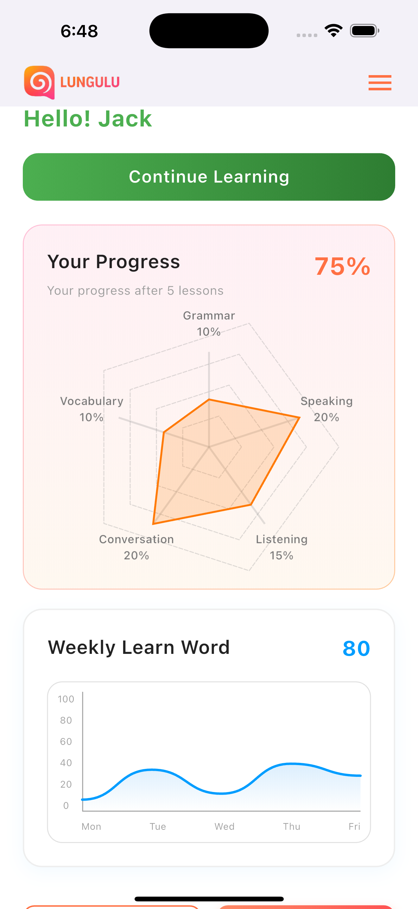
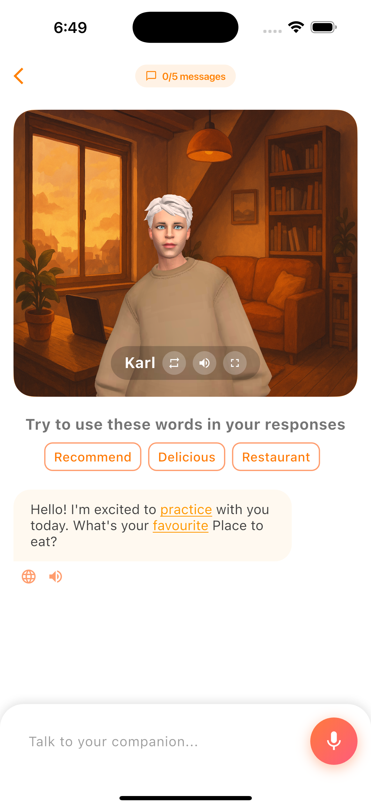
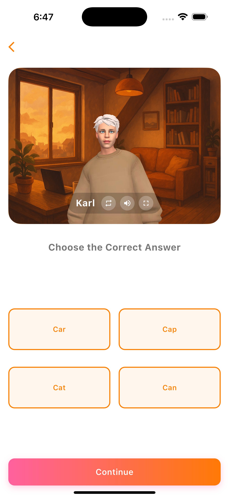

# Language Learning App (Lungulu)

A modern, interactive language learning application built with **Flutter**. This app combines 3D avatars, real-time speech recognition, and gamified progress tracking to provide an immersive learning experience.

<!-- 
    MOCKUPS SECTION 
    Replace the paths below with your actual screenshot or mockup files.
    Recommended size: 300px width for mobile screenshots.
-->
## 📱 Screens & Mockups

| **Home Dashboard** | **Conversation Mode** | **Vocabulary Quiz** |
|:---:|:---:|:---:|
|  |  |  |
| *Track your progress and weekly activity* | *Practice speaking with interactive avatars* | *Master new words with fun quizzes* |

---

## ✨ Key Features

- **🗣️ Interactive Conversation Practice**  
  Engage in realistic dialogues with 3D avatars (Clara & Karl). The app uses **Speech-to-Text** and **Text-to-Speech** to facilitate two-way communication.

- **🤖 3D Avatar Integration**  
  Features high-quality 3D avatars that react and animate during lessons.
  - **iOS:** Native `UiKitView` integration for USDZ models.
  - **Android/Web:** `model_viewer_plus` for seamless 3D rendering.

- **📚 Varied Lesson Types**  
  - **Vocabulary Building:** Multiple-choice questions, listening grids, and sentence completion.
  - **Listening Comprehension:** Audio-based challenges.

- **XB Gamified Progress Tracking**  
  - **Radar Charts:** Visualize your skills (Listening, Speaking, Vocabulary, Grammar).
  - **Weekly Activity:** Track the number of words learned each day.
  - **Levels & XP:** Stay motivated with a progression system.

- **🎨 Modern UI/UX**  
  - Clean, colorful interface with smooth animations (Lottie).
  - Responsive layout adapted for various screen sizes.

---

## 🛠️ Tech Stack

- **Framework:** [Flutter](https://flutter.dev/) (Dart)
- **State Management:** [Provider](https://pub.dev/packages/provider)
- **Architecture:** Feature-first / Clean Architecture

### Key Packages & Libraries

| Package | Purpose |
|pV |pV |
| `provider` | State Management (ChangeNotifier) |
| `speech_to_text` | Real-time speech recognition |
| `flutter_tts` | Text-to-Speech synthesis |
| `model_viewer_plus` | 3D Model rendering (Web/Android) |
| `fl_chart` | Data visualization (Radar & Bar charts) |
| `lottie` | High-quality animations |
| `http` | API communication (Ready for backend integration) |
| `shared_preferences` | Local data persistence |
| `webview_flutter` | Web content rendering |

---

## 📂 Project Structure

The project follows a **Feature-First** directory structure for better scalability and maintainability.

```
lib/
├── app/                  # App-wide configurations (Theme, Router, Constants)
├── core/                 # Shared utilities, widgets, and data layer
│   ├── data/             # Repositories (Mock & Real)
│   ├── models/           # Data models (JSON serialization)
│   ├── providers/        # Global providers (Auth, Theme, etc.)
│   └── services/         # External services (Audio, API clients)
├── features/             # Feature-specific modules
│   ├── auth/             # Authentication screens & logic
│   ├── avatar/           # 3D Avatar controllers & views
│   ├── home/             # Dashboard & main navigation
│   ├── conversation/     # Chat & Speech logic
│   ├── vocabulary/       # Quiz & Learning logic
│   └── onboarding/       # Intro screens
└── main.dart             # Entry point & MultiProvider setup
```

---

## 🚀 Getting Started

### Prerequisites
- [Flutter SDK](https://docs.flutter.dev/get-started/install) (Version >= 3.0.0 recommended)
- Android Studio / VS Code with Flutter extensions
- iOS Simulator (Mac only) or Android Emulator

### Installation

1. **Clone the repository:**
   ```bash
   git clone https://github.com/your-username/language-learning-app.git
   cd language-learning-app
   ```

2. **Install dependencies:**
   ```bash
   flutter pub get
   ```

3. **Run the app:**
   ```bash
   flutter run
   ```

### ⚠️ Note on 3D Avatars (iOS vs Android)
- **Android:** Uses `model_viewer_plus` which loads GLB/GLTF models.
- **iOS:** Uses native `UiKitView`. Ensure your `ios/Runner/Info.plist` has the necessary permissions for camera/microphone if AR features are enabled.

---

## 🧪 Testing

Run unit and widget tests:

```bash
flutter test
```

---

## 🤝 Contributing

Contributions are welcome! Please follow these steps:
1. Fork the project.
2. Create your feature branch (`git checkout -b feature/AmazingFeature`).
3. Commit your changes (`git commit -m 'Add some AmazingFeature'`).
4. Push to the branch (`git push origin feature/AmazingFeature`).
5. Open a Pull Request.

---

## 📄 License

This project is licensed under the MIT License - see the [LICENSE](LICENSE) file for details.